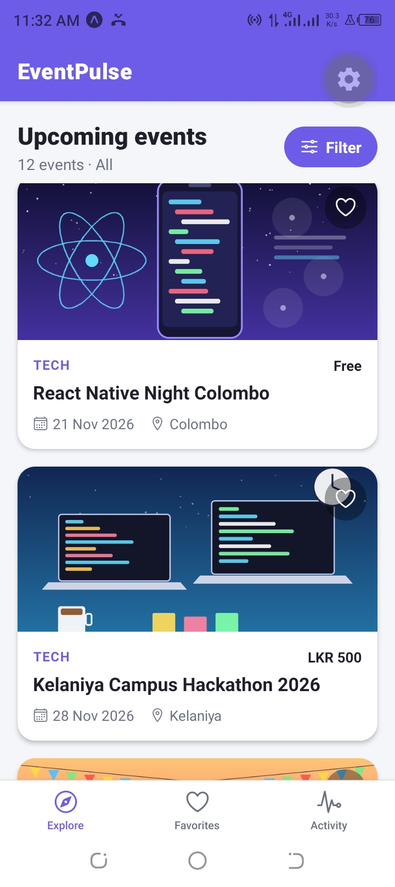
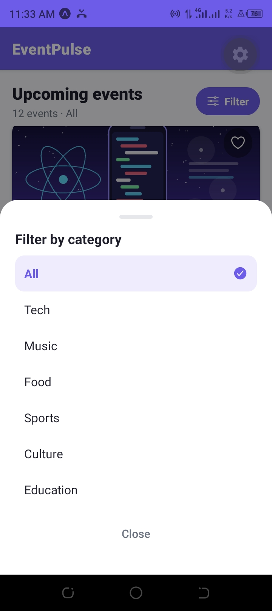
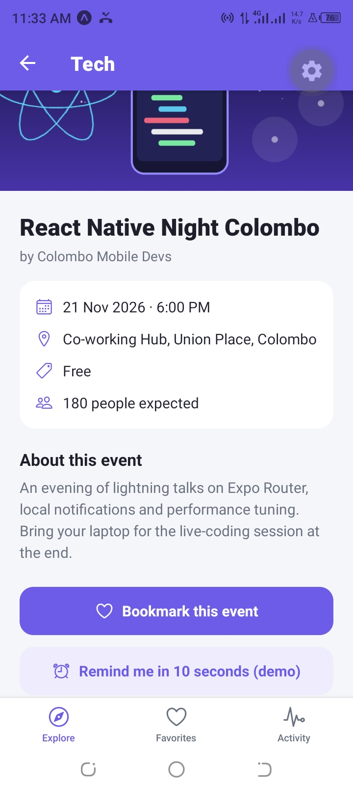
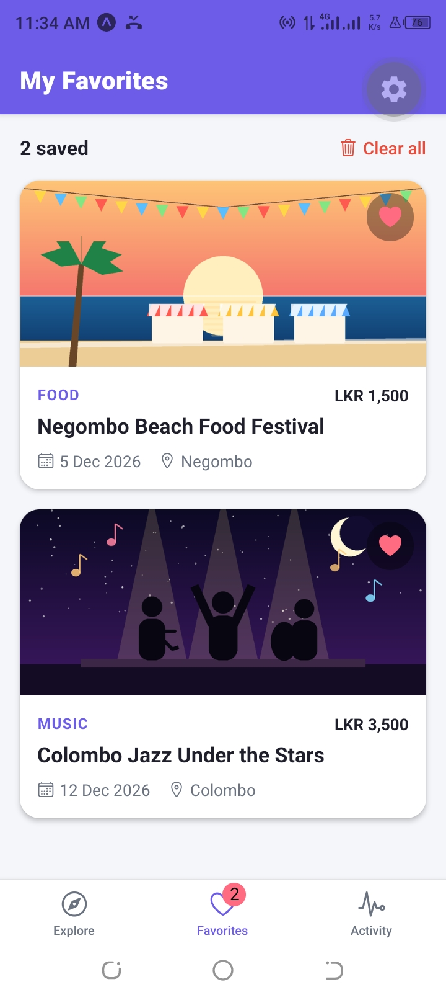
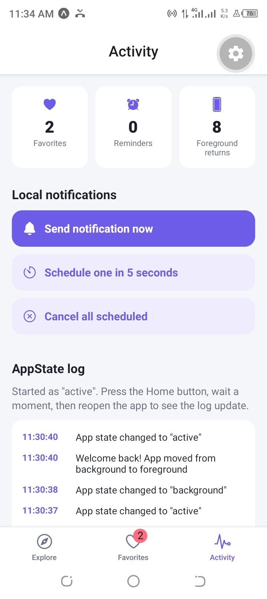

# EventPulse 📅 — Local Events Discovery App

> **Student Name:** `M.A.B.S.Maheshika Herath`
> **Student ID:** `FGS/MSc/CS/2025/030`
> **Course:** COSC 64173 Mobile Computing — Assignment 01 · University of Kelaniya
> **Demo Video:** `<PASTE YOUR UNLISTED YOUTUBE / GOOGLE DRIVE LINK HERE>`
> **GitHub Repository:** `https://github.com/Maashi-hub/eventpulse.git`

---

## 1. What is EventPulse and what problem does it solve?

EventPulse is a multi-screen mobile app (React Native + Expo Router, JavaScript) that helps students and locals in Sri Lanka **discover upcoming events** — tech meetups, concerts, food festivals, sports, cultural fairs and workshops — in one place.

**Problem:** event information is scattered across social-media posts, posters and group chats, so people miss events or forget the date. EventPulse lets users:

- browse a clean list of events and **filter by category**,
- open a **detail screen** with date, venue, price and description,
- **bookmark** events into a Favorites tab,
- receive **local notifications** (instant "Event bookmarked!" alerts and timed reminders),
- see an **activity log** that proves the app reacts when it returns from the background.

## 2. Screens (4 screens + 1 shared detail screen)

| # | Screen | Route file | Purpose |
|---|--------|------------|---------|
| 1 | **Explore** | `app/(tabs)/(home)/index.js` | FlatList of all events, category filter (Modal), heart button to favorite |
| 2 | **Event Details** (Explore stack) | `app/(tabs)/(home)/event/[id].js` | Full event info, bookmark button, "remind me in 10 s" button |
| 3 | **Favorites** | `app/(tabs)/favorites/index.js` | Shows bookmarked events from shared state, "Clear all" confirmation Modal |
| 4 | **Event Details** (Favorites stack) | `app/(tabs)/favorites/[id].js` | Same shared `EventDetails` component, keeps its own back-stack |
| 5 | **Activity** | `app/(tabs)/activity.js` | Stats, notification test buttons, live AppState log |

## 3. Core React Native components used and where

| Component / API | Where it is implemented |
|-----------------|-------------------------|
| `View`, `Text` | Every screen and component |
| `Image` | `components/EventCard.js` (card banner), `components/EventDetails.js` (hero image) |
| `Pressable` | `EventCard.js` (card + heart), `FilterModal.js`, `ConfirmModal.js`, `EventDetails.js` (buttons), `activity.js` |
| `FlatList` | `app/(tabs)/(home)/index.js` and `app/(tabs)/favorites/index.js` (renders data from `data/events.js`) |
| `Modal` (filter) | `components/FilterModal.js` — filters events by category |
| `Modal` (confirm) | `components/ConfirmModal.js` — confirms "Clear all favorites" |
| `ScrollView` | `EventDetails.js`, `activity.js` |
| `AppState` | `hooks/useAppStateListener.js` + `context/EventsContext.js` |
| `expo-notifications` | `services/notifications.js` |

## 4. How Expo Router is structured (`app/` directory)

```
app/
├── _layout.js                  # Root layout: providers, notification tap handler, WelcomeBack banner
├── +not-found.js               # 404 screen
└── (tabs)/
    ├── _layout.js              # TAB navigator: Explore | Favorites | Activity
    ├── activity.js             # Tab 3 (single screen)
    ├── (home)/
    │   ├── _layout.js          # nested STACK for the Explore tab
    │   ├── index.js            # list screen  -> route "/"
    │   └── event/[id].js       # detail screen -> route "/event/3"
    └── favorites/
        ├── _layout.js          # nested STACK for the Favorites tab
        ├── index.js            # list screen  -> route "/favorites"
        └── [id].js             # detail screen -> route "/favorites/3"
```

- `(tabs)` and `(home)` are **route groups**: the brackets mean they do not appear in the URL.
- Each tab owns a **nested stack**, so pressing a card pushes the detail screen with a working **back button / swipe-back / Android hardware back**.
- `[id].js` is a **dynamic route**; the screen reads the id with `useLocalSearchParams()`.

## 5. State management

Global state lives in **`context/EventsContext.js`** (React Context + standard `useState`). It stores `favoriteIds`, `reminderIds`, `appStateLog` and `foregroundCount`. Any screen calls `useEvents()` to read or update it, so favoriting an event on the Explore screen immediately updates the Favorites tab, the tab badge and the Activity stats.

## 6. AppState (background → foreground)

`hooks/useAppStateListener.js` registers `AppState.addEventListener('change', …)`. It remembers the previous state and, when the app goes from `background`/`inactive` to `active`, it calls `onForeground()`. The provider then:

1. increments the **"Foreground returns"** counter,
2. shows a green **"Welcome back!"** banner,
3. adds an entry to the **AppState log** on the Activity tab.

The subscription is removed in the effect cleanup to avoid memory leaks.

## 7. Local notifications — how I researched and implemented it

1. Read the official **Expo Notifications** docs (`https://docs.expo.dev/versions/latest/sdk/notifications/`) and learned the three steps: *set a handler*, *get permission*, *schedule a notification*.
2. Installed the package with `npx expo install expo-notifications` so the version matches my Expo SDK.
3. `Notifications.setNotificationHandler(...)` decides that notifications are shown as a banner even while the app is open.
4. On Android 8+ every notification needs a **channel**, so `setNotificationChannelAsync('default', …)` runs before asking permission with `requestPermissionsAsync()`.
5. **Immediate notification:** `scheduleNotificationAsync({ content, trigger: null })` — used for *"Event bookmarked! 🔖"* when the heart is pressed.
6. **Scheduled notification:** a `TIME_INTERVAL` trigger (`seconds: 10`) — used by the *"Remind me in 10 seconds"* button.
7. The notification `data.url` is used with Expo Router so tapping it opens the matching event screen.
8. Tested in the foreground and with the app in the background (remote push is **not** needed; this assignment uses local notifications only).

All code is in `services/notifications.js`.

## 8. Screenshots

> Add  screenshots to `docs/screenshots/` and keep these links.

| Explore | Filter Modal | Event Details |
|:---:|:---:|:---:|
|  |  |  |

| Favorites | Activity / AppState | Notification |
|:---:|:---:|:---:|
|  |  |  |

## 9. Run the project locally

**Prerequisites:** Node.js 20+ (LTS), Git, and the **Expo Go** app on your phone (or an Android emulator / iOS simulator).

```bash
# 1. Clone
git clone <YOUR_REPO_URL>
cd eventpulse

# 2. Install dependencies
npm install

# 3. Start the dev server
npx expo start
```

Scan the QR code with Expo Go (Android) or the Camera app (iOS). Press `a` for an Android emulator or `i` for an iOS simulator.
Phone and computer must be on the same Wi-Fi. If the QR code does not connect, run `npx expo start --tunnel`.

> Notifications and AppState need a real phone or an emulator — they do not work in the web preview.

## 10. Project structure

```
eventpulse/
├── app/            # Expo Router screens and layouts
├── components/     # EventCard, EventDetails, FilterModal, ConfirmModal, WelcomeBackBanner
├── context/        # EventsContext (global state)
├── data/           # events.js (12 hard-coded realistic events)
├── hooks/          # useAppStateListener
├── services/       # notifications.js
├── utils/          # date / price formatting
├── constants/      # theme colours
├── assets/         # icons + category banner images
└── docs/screenshots/
```

## 11. Demo video checklist

1. Explain the values populated in the app (event names, dates, prices in LKR).
2. Switch between the three tabs and open detail screens (and go back).
3. Favorite an event and show it on the Favorites tab; use the filter and clear-all modals.
4. Press Home, wait, reopen → show the "Welcome back" banner and AppState log.
5. Show the local notification arriving ("Event bookmarked!" and the 10-second reminder).
